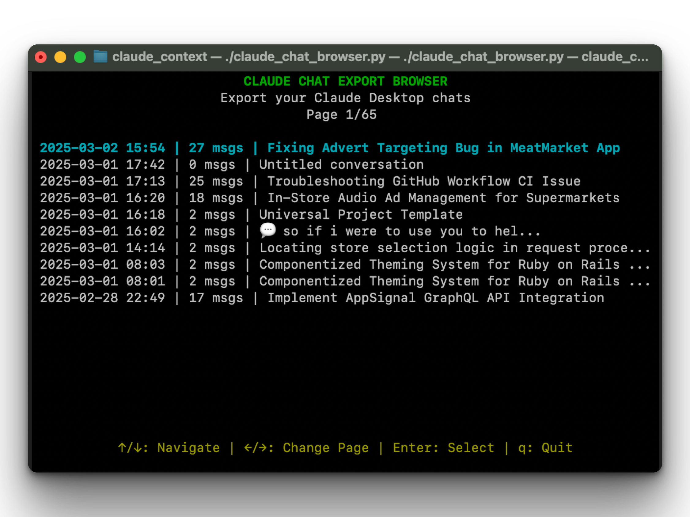

# Claude Chat Export Browser
Export your Claude Desktop chats to Markdown and JSON

A simple terminal tool that helps you browse and export conversations from your Claude AI assistant data exports. Get your chat history in both human-readable Markdown and structured JSON formats.



## Quick Start

1. Go to your [Claude account settings and export your data.](https://claude.ai/settings/account)
2. Once you receive the email, download the zip file.
3. Run the tool passing the zip file directly — no need to extract anything.
4. Browse your conversations with arrow keys.
5. Press Enter to select a conversation.
6. Press Y to export to Markdown and JSON.

## What You Can Do

- **Browse All Conversations**: Newest conversations appear first
- **See Previews**: View the first few messages before exporting
- **Export Easily**: Get both Markdown and JSON versions of any conversation
- **Read Chronologically**: Exported conversations are organized by time with timestamps
- **No Extra Software Needed**: Uses only standard Python libraries (Python 3.11+)

## How to Use

### Step 1: Get Your Claude Data

1. Go to [Claude account settings](https://claude.ai/settings/account) → Export Data
2. Download the ZIP file from the email — **do not extract it**

### Step 2: Run the Browser

```bash
# Make executable (first time only, Linux/macOS)
chmod +x claude_chat_browser.py

# Pass the zip file directly
./claude_chat_browser.py /path/to/claude_export.zip

# Or with Python explicitly
python claude_chat_browser.py /path/to/claude_export.zip
```

By default, exports are saved to an `exports/` folder next to the zip file. You can change that with `-o`:

```bash
python claude_chat_browser.py claude_export.zip -o ~/Documents/claude_exports
```

### Step 3: Navigate and Export

- **Navigate**: Use ↑/↓ arrows to select conversations
- **Change Pages**: Use ←/→ arrows to move between pages (10 conversations per page)
- **View Details**: Press Enter to see conversation details
- **Export**: Press Y when prompted to save as Markdown and JSON
- **Exit**: Press Q to quit

### What You Get

When you export a conversation, two files are created in the exports folder:

- **[date]_[name].md**: Easy-to-read Markdown with all messages in order
- **[date]_[name].json**: Complete structured data you can use in other tools

## Requirements

No dependencies to install — everything is standard Python 3.11+.

**Windows only**: the `curses` module is not included with Python on Windows, so you need to install it once:

```bash
pip install windows-curses
```

Linux and macOS need nothing extra.

## Tips

- The zip file is read entirely in memory — nothing is extracted to disk
- Exported conversations have timestamps so you can see when each message was sent
- Use the JSON exports if you want to process your conversations with other tools

For developer information, see [docs/DEVELOPMENT.md](docs/DEVELOPMENT.md).

## License

MIT License - See LICENSE file for details.